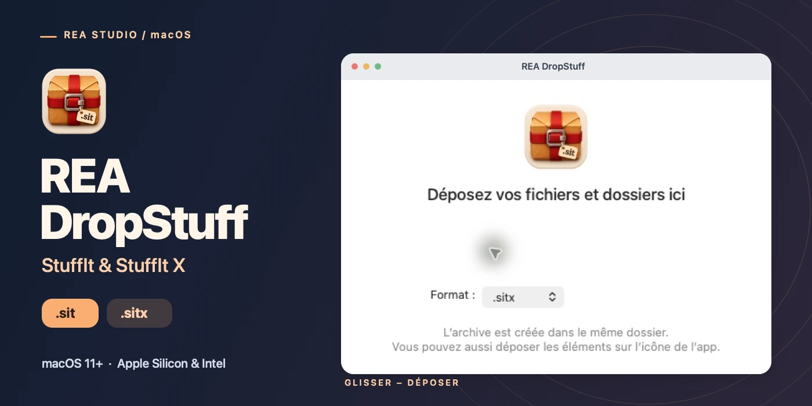
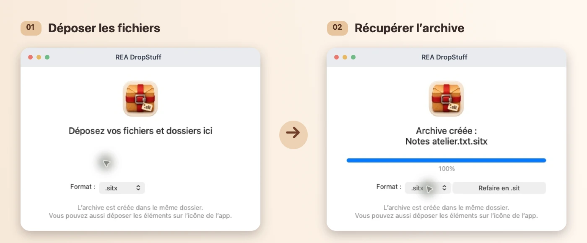

<h1 align="center">REA DropStuff</h1>

Créez des archives StuffIt par glisser-déposer sur votre Mac.

<strong><a href="https://rea.com.co/fr/applications/rea-dropstuff/download/">Télécharger REA DropStuff</a></strong> · <a href="https://rea.com.co/fr/applications/rea-dropstuff/">Site officiel</a> · <a href="README.md">English</a>

**macOS 11 ou ultérieur · Apple Silicon et Intel · Signé et notarisé**

REA DropStuff crée des archives `.sit` et `.sitx`. Déposez un ou plusieurs fichiers et dossiers dans la fenêtre ou sur l’icône de l’application. L’archive apparaît à côté du premier élément. Si le nom est déjà utilisé, DropStuff lui ajoute un numéro.

## Choisir le format

| Format | Résultat |
| --- | --- |
| **StuffIt · `.sit`** | Une archive StuffIt 5 classique qui conserve les fichiers sans compression. |
| **StuffIt X · `.sitx`** | Une archive StuffIt X compressée. Les données sont conservées telles quelles si la compression ne réduit pas leur taille. |

Une fois l’archive créée, cliquez sur **Refaire en…** pour reprendre les mêmes éléments dans l’autre format.

## Installer sur votre Mac

1. [Demandez le lien de téléchargement macOS sur le site officiel](https://rea.com.co/fr/applications/rea-dropstuff/download/).
2. Ouvrez l’image disque et glissez **REA DropStuff** dans **Applications**.
3. Lancez l’application, choisissez `.sit` ou `.sitx` et déposez vos fichiers ou dossiers.

L’interface est disponible en français, anglais, espagnol, portugais, allemand et italien.

Ce dépôt présente le produit. Le site officiel REA propose l’image disque macOS signée et notarisée.

[Présentation du produit](https://rea.com.co/fr/applications/rea-dropstuff/) · [Téléchargement officiel](https://rea.com.co/fr/applications/rea-dropstuff/download/) · [REA Studio](https://rea.com.co/fr/)
