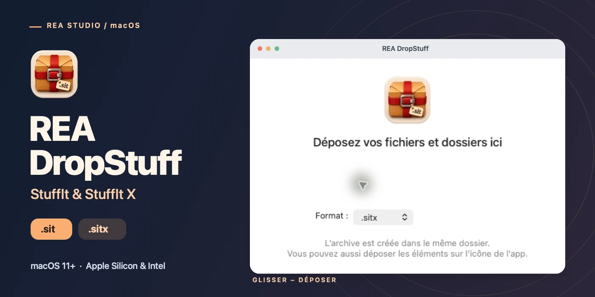
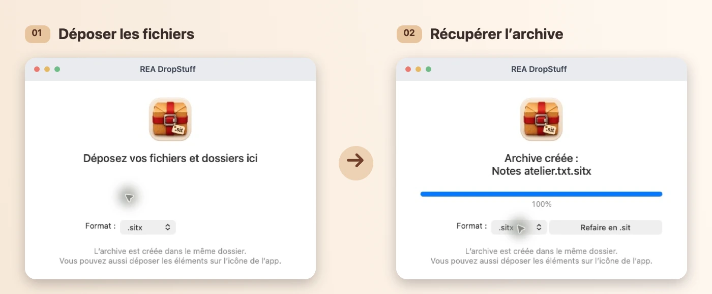

<h1 align="center">REA DropStuff</h1>

Drop files to create StuffIt archives on your Mac.

<strong><a href="https://github.com/rea-studio-repos/rea-dropstuff/releases/download/v1.1.3/REA-DropStuff-1.1.3-macOS.dmg">Download the DMG · 1.1.3</a></strong> · <a href="https://rea.com.co/en/applications/rea-dropstuff/">Official website</a> · <a href="README.fr.md">Français</a>

**macOS 11 or later · Apple Silicon and Intel · Signed and notarized**

REA DropStuff makes `.sit` and `.sitx` archives from files and folders. Drop one or more items into the window or onto the app icon. The archive appears beside the first item; if that name is already taken, DropStuff picks a numbered name.

## Choose your format

| Format | What it creates |
| --- | --- |
| **StuffIt · `.sit`** | A classic StuffIt 5 archive that stores files without compression. |
| **StuffIt X · `.sitx`** | A compressed StuffIt X archive. Data is stored as-is when compression would not save space. |

After creating an archive, use **Redo as…** to package the same items in the other format.

## Install on your Mac

1. [Download REA DropStuff 1.1.3 (.dmg)](https://github.com/rea-studio-repos/rea-dropstuff/releases/download/v1.1.3/REA-DropStuff-1.1.3-macOS.dmg).
2. Open the disk image and drag **REA DropStuff** into **Applications**.
3. Launch the app, choose `.sit` or `.sitx`, and drop in your files or folders.

The interface is available in English, French, Spanish, Portuguese, German and Italian.

This repository hosts the official installers and product documentation. The installer is the **DMG**; GitHub’s automatic ZIP and TAR.GZ archives do not contain the app or its source code.

[Release notes](https://github.com/rea-studio-repos/rea-dropstuff/releases/tag/v1.1.3) · [REA Studio](https://rea.com.co/en/)
